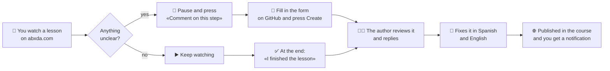
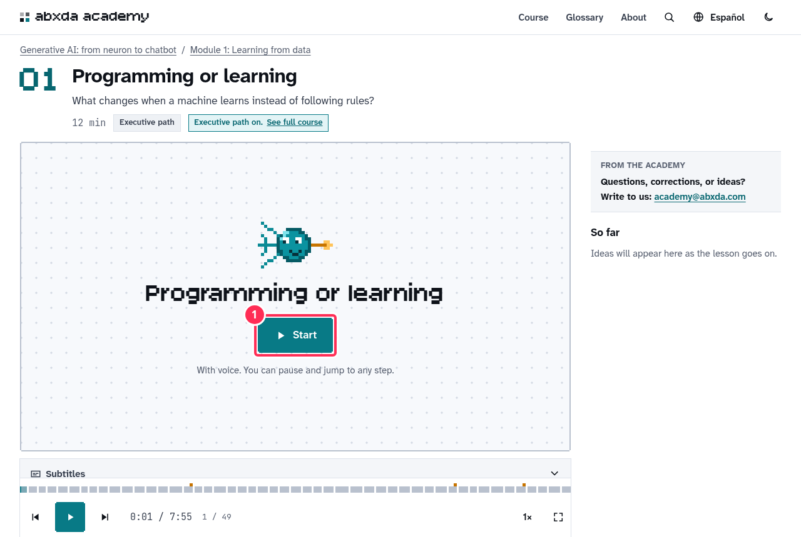
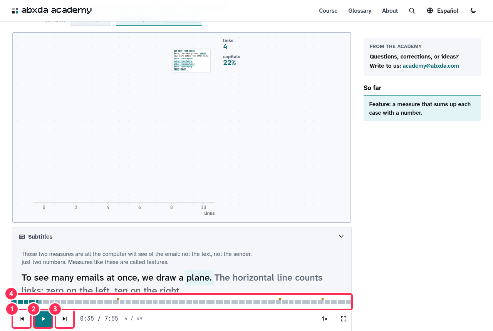
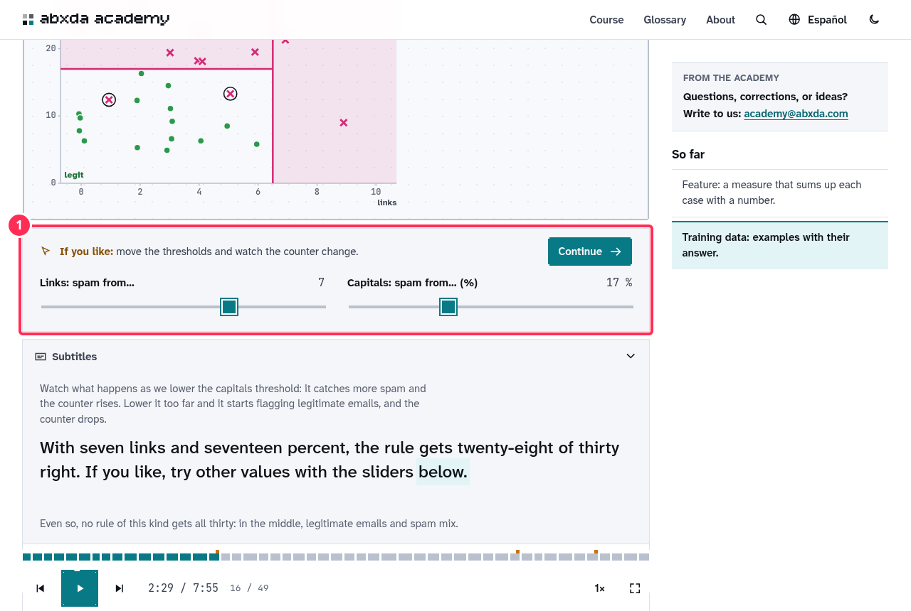
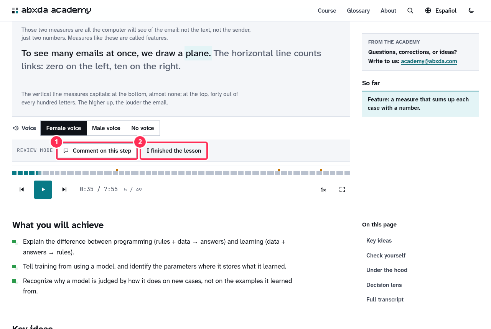
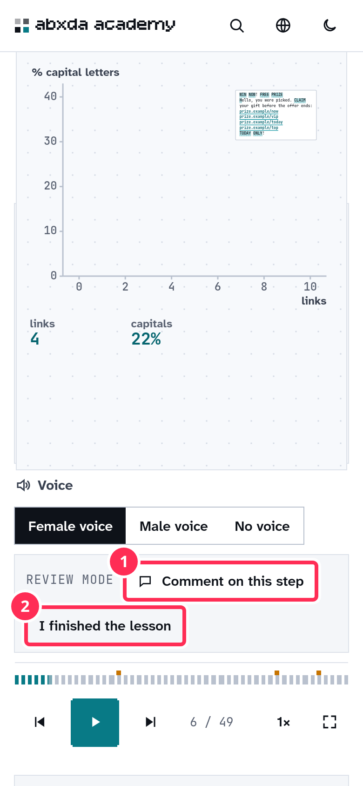

# How to review the course

> **Versión en español:** [REVISION.md](REVISION.md)

Thank you for helping review **"Generative AI: from neuron to chatbot"**. This guide walks you through it with screenshots. **You don't need to code or know GitHub**: everything happens in the browser, with two buttons.

## Why your eyes matter

The course is made for someone who **has never seen these topics**. If you haven't either, you are exactly the person we need. Every time you get lost, something goes too fast or a word isn't clear, that is what needs fixing. **There are no silly comments:** "I got lost here" is worth more than any technical correction.

Everything you write is **public** (the repository is open). Write naturally, as you would to a colleague.

## How it works, at a glance

---

## Part A · Setup (once, 5 minutes)

### A1. Sign in to GitHub

GitHub is where the course comments are kept. Sign in with your personal account at <https://github.com/login>:

1. Your username or email.
2. Your password.
3. **Sign in.**

You need no invitation or special permissions: the repository is public.

### A2. Turn on notifications

So you know when the author replies. Open the repository <https://github.com/abxda/abxda-academy>:

1. Press **Notifications** and choose **Participating and @mentions**.

### A3. Turn on the course's review mode

Open this link **once in each browser or phone** you will use:

### 👉 <https://abxda.com/academy/en/generative-ai/?revision=1>

The browser remembers it. All links in the [lesson inventory](#part-e--lesson-inventory) already include it. To turn it off: <https://abxda.com/academy/en/generative-ai/?revision=0>.

---

## Part B · Watching a lesson

### B1. Start

1. Press **Start**. The lesson plays by itself, with voice and animation, **one step at a time**.

### B2. The controls

1. **Previous step.**
2. **Play / pause** (also the space bar).
3. **Next step.**
4. **Timeline:** each tick is a step; tap any of them to jump there.

Above the controls are the **subtitles**: what the voice says, in case you want to read it.

### B3. The "If you like" moments (optional)

Sometimes a box appears saying **"If you like: …"** with something you can move:

1. **It's optional.** Try the control, or do nothing: the lesson carries on by itself after a few seconds. If you touch it, the lesson waits until you press **Continue**.

> If a step wasn't clear, **go back once** (button 1) before commenting. If it's still unclear, comment on it!

---

## Part C · Commenting on a step

### C1. Pause and press "Comment on this step"

With review mode on, you'll see a **REVIEW MODE** strip below the lesson:

1. **Comment on this step:** opens the form for the step you are watching.
2. **I finished the lesson:** use it at the end (see Part D).

On a phone it's in the same place, below the lesson:

### C2. Fill in the form

GitHub opens in another tab. **The lesson, step, language, device and what the voice said are already filled in.** You only complete three things:

1. **What happened?** Pick the closest option (for example "No lo entendí / me perdí" — I didn't understand / I got lost — or "Va demasiado rápido" — too fast).
2. **In your own words:** what you expected to understand and what you understood. You can **paste a screenshot** (drag it into the box or paste it with Ctrl+V).
3. **What would have helped?** (optional): any idea is welcome.
4. Press **Create**. Done: go back to the course tab and continue.

*(The picture illustrates the form; on GitHub it looks almost the same. The form is bilingual; the options are in Spanish.)*

### C3. What your comment looks like

1. Your comment gets a number (for example **#1**). The author reads it, replies there and, once fixed, closes it with a link to the change. See the full example: <https://github.com/abxda/abxda-academy/issues/1>.

---

## Part D · When you finish each lesson

Press **I finished the lesson** (button 2 in the strip) and fill in the short form: how clear it was (1 to 5), **the main idea in your own words**, the hardest part and about how long it took. Example: <https://github.com/abxda/abxda-academy/issues/2>.

"In your own words" matters: **don't look up the answer in the lesson.** It tells us what really sticks after watching it.

---

## Part E · Lesson inventory

Click a title to open the lesson **already in review mode**. "Comments on this lesson" shows what has been said about it. Start with **Part 1, in order**; one or two lessons per session is a good pace.

### Part 1 · How a machine learns — **start here**

| # | Lesson (opens in review mode) | Min | Comments on this lesson |
|---|---|---|---|
| | **Module 1 · Learning from data** | | |
| 1 | [Programming or learning](https://abxda.com/academy/en/generative-ai/lessons/programming-vs-learning/?revision=1) | 12 | [see](https://github.com/abxda/abxda-academy/issues?q=is%3Aissue%20%22%5Bque-es-aprender%22) |
| 2 | [The world as numbers](https://abxda.com/academy/en/generative-ai/lessons/the-world-as-numbers/?revision=1) | 10 | [see](https://github.com/abxda/abxda-academy/issues?q=is%3Aissue%20%22%5Bdatos-como-numeros%22) |
| 3 | [A model and its error](https://abxda.com/academy/en/generative-ai/lessons/a-model-and-its-error/?revision=1) | 11 | [see](https://github.com/abxda/abxda-academy/issues?q=is%3Aissue%20%22%5Bmodelo-y-error%22) |
| 4 | [Gradient descent](https://abxda.com/academy/en/generative-ai/lessons/gradient-descent/?revision=1) | 10 | [see](https://github.com/abxda/abxda-academy/issues?q=is%3Aissue%20%22%5Bdescenso-del-gradiente%22) |
| | **Module 2 · Neural networks** | | |
| 5 | [The artificial neuron](https://abxda.com/academy/en/generative-ai/lessons/the-artificial-neuron/?revision=1) | 11 | [see](https://github.com/abxda/abxda-academy/issues?q=is%3Aissue%20%22%5Bneurona%22) |
| 6 | [What a neuron cannot do](https://abxda.com/academy/en/generative-ai/lessons/what-a-neuron-cannot-do/?revision=1) | 6 | [see](https://github.com/abxda/abxda-academy/issues?q=is%3Aissue%20%22%5Blimite-xor%22) |
| 7 | [Layers and activations](https://abxda.com/academy/en/generative-ai/lessons/layers-and-activations/?revision=1) | 10 | [see](https://github.com/abxda/abxda-academy/issues?q=is%3Aissue%20%22%5Bcapas-y-activaciones%22) |
| 8 | [Backpropagation](https://abxda.com/academy/en/generative-ai/lessons/backpropagation/?revision=1) | 9 | [see](https://github.com/abxda/abxda-academy/issues?q=is%3Aissue%20%22%5Bbackpropagation%22) |
| 9 | [Training well: batches, epochs, and optimizers](https://abxda.com/academy/en/generative-ai/lessons/training-well/?revision=1) | 12 | [see](https://github.com/abxda/abxda-academy/issues?q=is%3Aissue%20%22%5Bentrenar-bien%22) |
| 10 | [Generalizing and evaluating](https://abxda.com/academy/en/generative-ai/lessons/generalizing-and-evaluating/?revision=1) | 9 | [see](https://github.com/abxda/abxda-academy/issues?q=is%3Aissue%20%22%5Bgeneralizar-y-evaluar%22) |
| | **Module 3 · Deep learning** | | |
| 11 | [Convolutions and vision](https://abxda.com/academy/en/generative-ai/lessons/convolutions-and-vision/?revision=1) | 6 | [see](https://github.com/abxda/abxda-academy/issues?q=is%3Aissue%20%22%5Bconvoluciones%22) |
| 12 | [Sequences and memory](https://abxda.com/academy/en/generative-ai/lessons/sequences-and-memory/?revision=1) | 10 | [see](https://github.com/abxda/abxda-academy/issues?q=is%3Aissue%20%22%5Bsecuencias-y-memoria%22) |
| 13 | [The deep learning big bang](https://abxda.com/academy/en/generative-ai/lessons/the-deep-learning-big-bang/?revision=1) | 10 | [see](https://github.com/abxda/abxda-academy/issues?q=is%3Aissue%20%22%5Bbig-bang-deep-learning%22) |
| 14 | [Embeddings: meaning as geometry](https://abxda.com/academy/en/generative-ai/lessons/embeddings-meaning-as-geometry/?revision=1) | 11 | [see](https://github.com/abxda/abxda-academy/issues?q=is%3Aissue%20%22%5Bembeddings%22) |

### Part 2 · Generating: images and language — new text; some lessons still without voice

| # | Lesson (opens in review mode) | Min | Comments on this lesson |
|---|---|---|---|
| | **Module 4 · Generating images** | | |
| 15 | [Generating is learning a distribution](https://abxda.com/academy/en/generative-ai/lessons/generating-is-learning-a-distribution/?revision=1) | 10 | [see](https://github.com/abxda/abxda-academy/issues?q=is%3Aissue%20%22%5Bgenerar-distribuciones%22) |
| 16 | [GANs: the forger and the detective](https://abxda.com/academy/en/generative-ai/lessons/generative-adversarial-networks/?revision=1) | 6 | [see](https://github.com/abxda/abxda-academy/issues?q=is%3Aissue%20%22%5Bgans%22) |
| 17 | [Diffusion: from noise to image](https://abxda.com/academy/en/generative-ai/lessons/diffusion-models/?revision=1) | 6 | [see](https://github.com/abxda/abxda-academy/issues?q=is%3Aissue%20%22%5Bdifusion%22) |
| 18 | [From text to image](https://abxda.com/academy/en/generative-ai/lessons/from-text-to-image/?revision=1) | 7 | [see](https://github.com/abxda/abxda-academy/issues?q=is%3Aissue%20%22%5Btexto-a-imagen%22) |
| | **Module 5 · Transformers and language** | | |
| 19 | [Predicting the next word](https://abxda.com/academy/en/generative-ai/lessons/predicting-the-next-word/?revision=1) | 8 | [see](https://github.com/abxda/abxda-academy/issues?q=is%3Aissue%20%22%5Bsiguiente-palabra%22) |
| 20 | [Tokens: the model’s alphabet](https://abxda.com/academy/en/generative-ai/lessons/tokens/?revision=1) | 7 | [see](https://github.com/abxda/abxda-academy/issues?q=is%3Aissue%20%22%5Btokens%22) |
| 21 | [Attention](https://abxda.com/academy/en/generative-ai/lessons/attention/?revision=1) | 10 | [see](https://github.com/abxda/abxda-academy/issues?q=is%3Aissue%20%22%5Batencion%22) |
| 22 | [The complete transformer](https://abxda.com/academy/en/generative-ai/lessons/the-transformer/?revision=1) | 9 | [see](https://github.com/abxda/abxda-academy/issues?q=is%3Aissue%20%22%5Btransformer%22) |
| | **Module 6 · Scale** | | |
| 23 | [Pretraining](https://abxda.com/academy/en/generative-ai/lessons/pretraining/?revision=1) | 8 | [see](https://github.com/abxda/abxda-academy/issues?q=is%3Aissue%20%22%5Bpreentrenamiento%22) |
| 24 | [Scaling laws and costs](https://abxda.com/academy/en/generative-ai/lessons/scaling-laws-and-costs/?revision=1) | 8 | [see](https://github.com/abxda/abxda-academy/issues?q=is%3Aissue%20%22%5Bleyes-escala-costos%22) |
| 25 | [GPUs, memory, and quantization](https://abxda.com/academy/en/generative-ai/lessons/gpus-memory-and-quantization/?revision=1) | 8 | [see](https://github.com/abxda/abxda-academy/issues?q=is%3Aissue%20%22%5Bhardware-y-memoria%22) |
| 26 | [Inference: how a model answers](https://abxda.com/academy/en/generative-ai/lessons/inference-how-a-model-answers/?revision=1) | 10 | [see](https://github.com/abxda/abxda-academy/issues?q=is%3Aissue%20%22%5Binferencia%22) |

### Part 3 · From model to assistant to decision — new text; some lessons still without voice

| # | Lesson (opens in review mode) | Min | Comments on this lesson |
|---|---|---|---|
| | **Module 7 · From model to assistant** | | |
| 27 | [Fine-tuning and LoRA](https://abxda.com/academy/en/generative-ai/lessons/fine-tuning-and-lora/?revision=1) | 8 | [see](https://github.com/abxda/abxda-academy/issues?q=is%3Aissue%20%22%5Bfine-tuning-lora%22) |
| 28 | [From base model to assistant](https://abxda.com/academy/en/generative-ai/lessons/aligning-assistants/?revision=1) | 9 | [see](https://github.com/abxda/abxda-academy/issues?q=is%3Aissue%20%22%5Balineacion%22) |
| 29 | [Reasoning models](https://abxda.com/academy/en/generative-ai/lessons/reasoning-models/?revision=1) | 8 | [see](https://github.com/abxda/abxda-academy/issues?q=is%3Aissue%20%22%5Brazonamiento%22) |
| 30 | [Context and memory](https://abxda.com/academy/en/generative-ai/lessons/context-and-memory/?revision=1) | 9 | [see](https://github.com/abxda/abxda-academy/issues?q=is%3Aissue%20%22%5Bcontexto-y-memoria%22) |
| 31 | [RAG: read before answering](https://abxda.com/academy/en/generative-ai/lessons/rag-read-before-answering/?revision=1) | 8 | [see](https://github.com/abxda/abxda-academy/issues?q=is%3Aissue%20%22%5Brag%22) |
| 32 | [Agents and tools](https://abxda.com/academy/en/generative-ai/lessons/agents-and-tools/?revision=1) | 10 | [see](https://github.com/abxda/abxda-academy/issues?q=is%3Aissue%20%22%5Bagentes%22) |
| | **Module 8 · Using AI with judgment** | | |
| 33 | [Hallucinations and limits](https://abxda.com/academy/en/generative-ai/lessons/hallucinations-and-limits/?revision=1) | 9 | [see](https://github.com/abxda/abxda-academy/issues?q=is%3Aissue%20%22%5Balucinaciones-y-limites%22) |
| 34 | [Evaluating AI systems](https://abxda.com/academy/en/generative-ai/lessons/evaluating-ai-systems/?revision=1) | 10 | [see](https://github.com/abxda/abxda-academy/issues?q=is%3Aissue%20%22%5Bevaluar%22) |
| 35 | [Risks and governance](https://abxda.com/academy/en/generative-ai/lessons/risks-and-governance/?revision=1) | 8 | [see](https://github.com/abxda/abxda-academy/issues?q=is%3Aissue%20%22%5Briesgos-y-gobernanza%22) |
| 36 | [Strategy for organizations](https://abxda.com/academy/en/generative-ai/lessons/strategy-for-organizations/?revision=1) | 9 | [see](https://github.com/abxda/abxda-academy/issues?q=is%3Aissue%20%22%5Bestrategia%22) |
| | **Module 9 · Wrap-up** | | |
| 37 | [The complete map](https://abxda.com/academy/en/generative-ai/lessons/the-complete-map/?revision=1) | 6 | [see](https://github.com/abxda/abxda-academy/issues?q=is%3Aissue%20%22%5Bmapa-completo%22) |

---

## Part F · Follow-up

- **All your comments:** <https://github.com/abxda/abxda-academy/issues?q=author%3A%40me>
- **Lessons you have finished:** <https://github.com/abxda/abxda-academy/issues?q=author%3A%40me+label%3A%22lecci%C3%B3n+terminada%22>
- When the author replies, you get a notification (email and the GitHub bell). If the fix works for you, reply "Done, it's clear now".

## Frequently asked questions

- **What if I made a typo?** Open your comment, press the three dots **⋯** on your message and choose **Edit**.
- **Can I comment on something general, not a step?** Yes: use "Comment on this step" on any step and say so in the text.
- **Can I review in Spanish?** Yes: turn on review mode at <https://abxda.com/academy/es/ia-generativa/?revision=1>. Whatever you report in one language is fixed in both.
- **Anything I shouldn't do?** Don't include personal data or passwords in screenshots, and remember everything is public.
- **Can I suggest the exact wording?** Yes, write it under "What would have helped?". (Editing the file directly on GitHub is possible, but not needed.)

## GitHub words you'll see

| Word | What it is |
|---|---|
| **Issue** | A comment or report. Each "Comment on this step" creates one. |
| **Label** | A tag to sort comments (for example "revisión" or "me perdí"). |
| **Open / Closed** | Pending or resolved. |
| **Notifications** | Alerts you get when someone replies. |
| **Pull request** | A proposed text change. You don't need it to review. |

Questions about the review? Write to [academy@abxda.com](mailto:academy@abxda.com).
