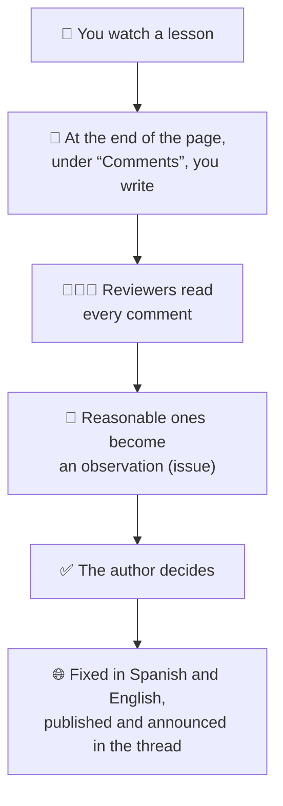
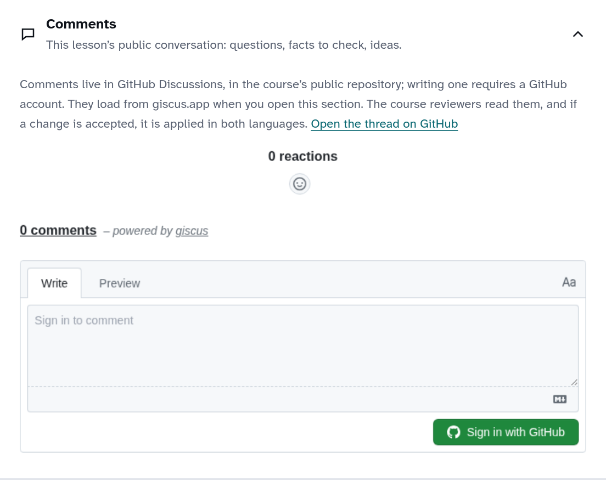

# Guide to reviewing the course

> **Versión en español:** [REVISION.md](REVISION.md)

Thank you for helping review **“Generative AI: from the neuron to the chatbot”**. You don’t need to code: everything happens in the browser.

The course is for people who have **never seen these topics**. If you get lost, if something goes too fast or a word is unclear, that is exactly what needs improving. **There are no silly comments.** Everything is public: write naturally.

## How it works

Each lesson has **its own comment thread**, shared by Spanish and English.

## 1. Setup (once)

1. Sign in to GitHub: <https://github.com/login>.
2. Turn on notifications: at <https://github.com/abxda/abxda-academy> click **Watch → Custom**, tick **Discussions** and **Issues**, then **Apply**.

## 2. Watch a lesson and comment

1. Open a lesson from the [list](#5-lessons) and watch it all the way through.
2. Scroll to the end of the page and open **Comments**:

   

3. The first time, click **Sign in with GitHub** and authorize *giscus* (it only posts under your name).
4. Write **where** (the sentence or the minute), **what was unclear** and, if you can, **what would have helped**.
5. If someone already said the same, give it a 👍 and add yours as a reply.

> Want to point at an exact step? Optional: turn on review mode with <https://abxda.com/academy/en/generative-ai/?revision=1> and use **Comment on this step** (it fills in the lesson, step, language and narration). To turn it off: `?revision=0`.

## 3. Your role as a reviewer

Besides commenting, read what other people write in the threads: <https://github.com/abxda/abxda-academy/discussions>.

- **If a comment is reasonable** (something confusing, a doubtful fact, a good idea): in the comment’s **⋯** menu choose **Reference in new issue**, explain in two lines what you propose and create it. Then reply in the thread: “Moved to review: #number”.
- **If it doesn’t apply**, reply kindly and explain why.
- **Nothing changes without the author’s approval.** When a change is published, the issue is closed with the link and the thread is notified.

## 4. When you finish a lesson (optional)

Leave a short comment in its thread: how clear it was (1 to 5), **the main idea in your own words** (without looking it up in the lesson) and how long it took.

## 5. Lessons

Start with part 1, in order. One or two lessons per session is a good pace.

| # | Lesson | Min | Comments |
|---|---|---|---|
| | **Part 1 · How a machine learns** | | |
| 1 | [Programming or learning](https://abxda.com/academy/en/generative-ai/lessons/programming-vs-learning/) | 12 | [thread](https://github.com/abxda/abxda-academy/discussions/3) |
| 2 | [The world as numbers](https://abxda.com/academy/en/generative-ai/lessons/the-world-as-numbers/) | 10 | [thread](https://github.com/abxda/abxda-academy/discussions/4) |
| 3 | [A model and its error](https://abxda.com/academy/en/generative-ai/lessons/a-model-and-its-error/) | 11 | [thread](https://github.com/abxda/abxda-academy/discussions/5) |
| 4 | [Gradient descent](https://abxda.com/academy/en/generative-ai/lessons/gradient-descent/) | 10 | [thread](https://github.com/abxda/abxda-academy/discussions/6) |
| 5 | [The artificial neuron](https://abxda.com/academy/en/generative-ai/lessons/the-artificial-neuron/) | 11 | [thread](https://github.com/abxda/abxda-academy/discussions/7) |
| 6 | [What a neuron cannot do](https://abxda.com/academy/en/generative-ai/lessons/what-a-neuron-cannot-do/) | 6 | [thread](https://github.com/abxda/abxda-academy/discussions/8) |
| 7 | [Layers and activations](https://abxda.com/academy/en/generative-ai/lessons/layers-and-activations/) | 10 | [thread](https://github.com/abxda/abxda-academy/discussions/9) |
| 8 | [Backpropagation](https://abxda.com/academy/en/generative-ai/lessons/backpropagation/) | 9 | [thread](https://github.com/abxda/abxda-academy/discussions/10) |
| 9 | [Training well: batches, epochs, and optimizers](https://abxda.com/academy/en/generative-ai/lessons/training-well/) | 12 | [thread](https://github.com/abxda/abxda-academy/discussions/11) |
| 10 | [Generalizing and evaluating](https://abxda.com/academy/en/generative-ai/lessons/generalizing-and-evaluating/) | 9 | [thread](https://github.com/abxda/abxda-academy/discussions/12) |
| 11 | [Convolutions and vision](https://abxda.com/academy/en/generative-ai/lessons/convolutions-and-vision/) | 6 | [thread](https://github.com/abxda/abxda-academy/discussions/13) |
| 12 | [Sequences and memory](https://abxda.com/academy/en/generative-ai/lessons/sequences-and-memory/) | 10 | [thread](https://github.com/abxda/abxda-academy/discussions/14) |
| 13 | [The deep learning big bang](https://abxda.com/academy/en/generative-ai/lessons/the-deep-learning-big-bang/) | 10 | [thread](https://github.com/abxda/abxda-academy/discussions/15) |
| 14 | [Embeddings: meaning as geometry](https://abxda.com/academy/en/generative-ai/lessons/embeddings-meaning-as-geometry/) | 11 | [thread](https://github.com/abxda/abxda-academy/discussions/16) |
| | **Part 2 · Generating: images and language** | | |
| 15 | [Generating is learning a distribution](https://abxda.com/academy/en/generative-ai/lessons/generating-is-learning-a-distribution/) | 10 | [thread](https://github.com/abxda/abxda-academy/discussions/17) |
| 16 | [GANs: the forger and the detective](https://abxda.com/academy/en/generative-ai/lessons/generative-adversarial-networks/) | 11 | [thread](https://github.com/abxda/abxda-academy/discussions/18) |
| 17 | [Diffusion: from noise to image](https://abxda.com/academy/en/generative-ai/lessons/diffusion-models/) | 12 | [thread](https://github.com/abxda/abxda-academy/discussions/19) |
| 18 | [From text to image](https://abxda.com/academy/en/generative-ai/lessons/from-text-to-image/) | 13 | [thread](https://github.com/abxda/abxda-academy/discussions/20) |
| 19 | [Predicting the next word](https://abxda.com/academy/en/generative-ai/lessons/predicting-the-next-word/) | 11 | [thread](https://github.com/abxda/abxda-academy/discussions/21) |
| 20 | [Tokens: the model’s alphabet](https://abxda.com/academy/en/generative-ai/lessons/tokens/) | 11 | [thread](https://github.com/abxda/abxda-academy/discussions/22) |
| 21 | [Attention](https://abxda.com/academy/en/generative-ai/lessons/attention/) | 12 | [thread](https://github.com/abxda/abxda-academy/discussions/23) |
| 22 | [The complete transformer](https://abxda.com/academy/en/generative-ai/lessons/the-transformer/) | 12 | [thread](https://github.com/abxda/abxda-academy/discussions/24) |
| 23 | [Pretraining](https://abxda.com/academy/en/generative-ai/lessons/pretraining/) | 13 | [thread](https://github.com/abxda/abxda-academy/discussions/25) |
| 24 | [Scaling laws and costs](https://abxda.com/academy/en/generative-ai/lessons/scaling-laws-and-costs/) | 13 | [thread](https://github.com/abxda/abxda-academy/discussions/26) |
| 25 | [GPUs, memory, and quantization](https://abxda.com/academy/en/generative-ai/lessons/gpus-memory-and-quantization/) | 13 | [thread](https://github.com/abxda/abxda-academy/discussions/27) |
| 26 | [Inference: how a model answers](https://abxda.com/academy/en/generative-ai/lessons/inference-how-a-model-answers/) | 13 | [thread](https://github.com/abxda/abxda-academy/discussions/28) |
| | **Part 3 · From model to assistant to decision** | | |
| 27 | [Fine-tuning and LoRA](https://abxda.com/academy/en/generative-ai/lessons/fine-tuning-and-lora/) | 11 | [thread](https://github.com/abxda/abxda-academy/discussions/29) |
| 28 | [From base model to assistant](https://abxda.com/academy/en/generative-ai/lessons/aligning-assistants/) | 14 | [thread](https://github.com/abxda/abxda-academy/discussions/30) |
| 29 | [Reasoning models](https://abxda.com/academy/en/generative-ai/lessons/reasoning-models/) | 12 | [thread](https://github.com/abxda/abxda-academy/discussions/31) |
| 30 | [Context and memory](https://abxda.com/academy/en/generative-ai/lessons/context-and-memory/) | 12 | [thread](https://github.com/abxda/abxda-academy/discussions/32) |
| 31 | [RAG: read before answering](https://abxda.com/academy/en/generative-ai/lessons/rag-read-before-answering/) | 13 | [thread](https://github.com/abxda/abxda-academy/discussions/33) |
| 32 | [Agents and tools](https://abxda.com/academy/en/generative-ai/lessons/agents-and-tools/) | 13 | [thread](https://github.com/abxda/abxda-academy/discussions/34) |
| 33 | [Hallucinations and limits](https://abxda.com/academy/en/generative-ai/lessons/hallucinations-and-limits/) | 12 | [thread](https://github.com/abxda/abxda-academy/discussions/35) |
| 34 | [Evaluating AI systems](https://abxda.com/academy/en/generative-ai/lessons/evaluating-ai-systems/) | 12 | [thread](https://github.com/abxda/abxda-academy/discussions/36) |
| 35 | [Risks and governance](https://abxda.com/academy/en/generative-ai/lessons/risks-and-governance/) | 13 | [thread](https://github.com/abxda/abxda-academy/discussions/37) |
| 36 | [Strategy for organizations](https://abxda.com/academy/en/generative-ai/lessons/strategy-for-organizations/) | 12 | [thread](https://github.com/abxda/abxda-academy/discussions/38) |
| 37 | [The complete map](https://abxda.com/academy/en/generative-ai/lessons/the-complete-map/) | 11 | [thread](https://github.com/abxda/abxda-academy/discussions/39) |

## Follow-up

- Threads you took part in: <https://github.com/abxda/abxda-academy/discussions?discussions_q=involves%3A%40me>
- Your observations (issues): <https://github.com/abxda/abxda-academy/issues?q=author%3A%40me>

## GitHub words

| Word | What it is |
|---|---|
| **Discussion** | A lesson’s comment thread. |
| **Issue** | A concrete observation to fix. |
| **Reference in new issue** | Turns a comment into an issue, linked to the original. |
| **Watch** | Get notifications from the repository. |

Questions? Write to [academy@abxda.com](mailto:academy@abxda.com).
