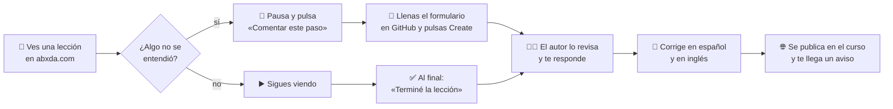
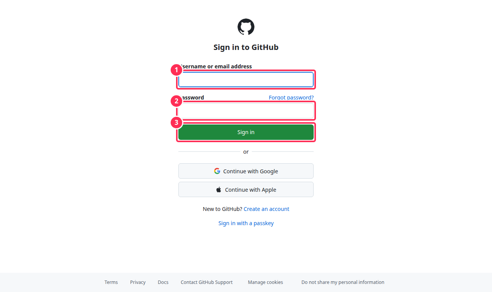
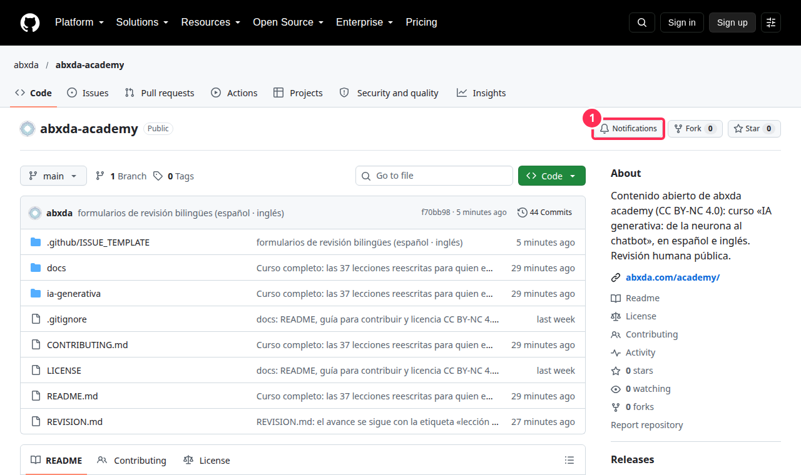
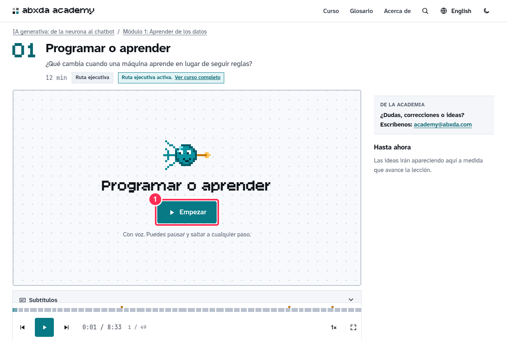
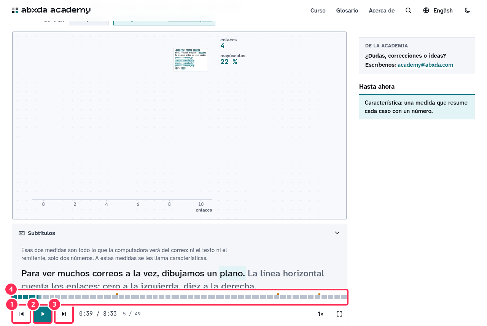
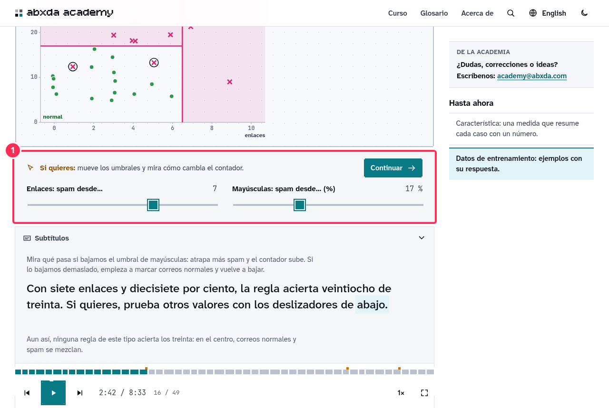
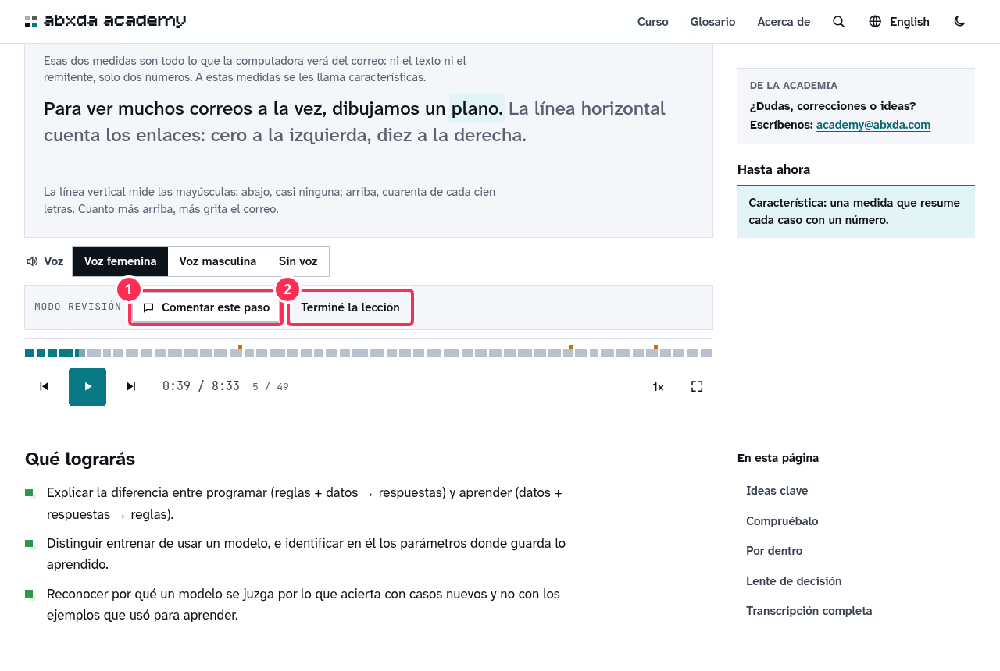
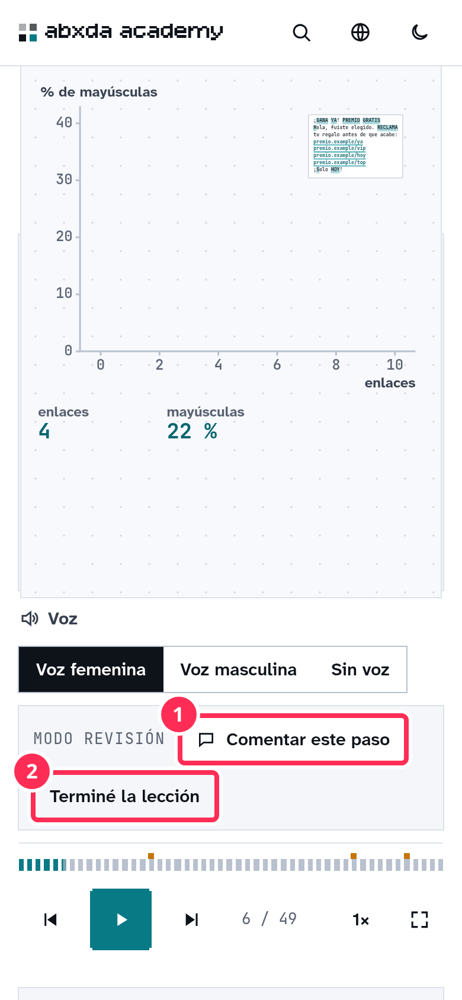
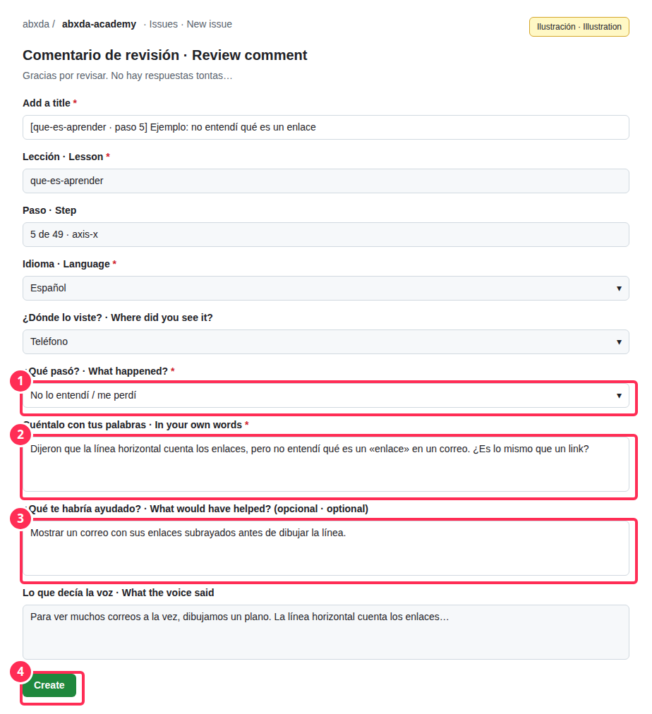
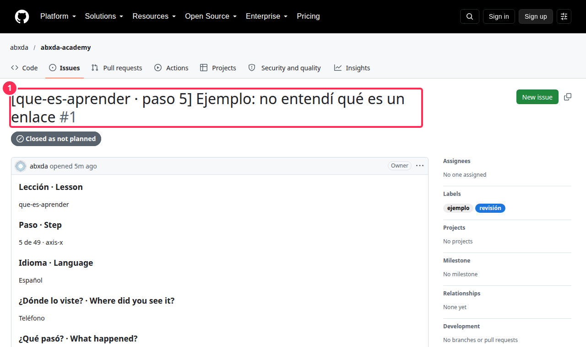

# Guía para revisar el curso

> **English version:** [REVIEWING.md](REVIEWING.md)

Gracias por ayudar a revisar **«IA generativa: de la neurona al chatbot»**. Esta guía te lleva de la mano, con capturas de pantalla. **No necesitas saber programar ni conocer GitHub**: todo se hace desde el navegador, con dos botones.

## Por qué tu mirada importa

El curso está hecho para alguien que **nunca ha visto estos temas**. Si tú tampoco los conoces, eres exactamente la persona que necesitamos. Cada vez que te pierdas, que algo vaya muy rápido o que una palabra no se entienda, eso es lo que hay que mejorar. **No hay comentarios tontos:** un «aquí me perdí» vale más que cualquier corrección técnica.

Todo lo que escribas es **público** (el repositorio está abierto). Escribe con naturalidad, como se lo dirías a un compañero.

## Así funciona, de un vistazo

---

## Parte A · Preparación (una sola vez, 5 minutos)

### A1. Entra a GitHub

GitHub es el sitio donde se guardan los comentarios del curso. Ya tienes una cuenta personal; solo entra con ella en <https://github.com/login>:

1. Tu usuario o correo.
2. Tu contraseña.
3. **Sign in** (entrar).

No necesitas invitación ni permisos especiales: el repositorio es público.

### A2. Activa los avisos

Así te enterarás cuando el autor responda tus comentarios. Abre el repositorio <https://github.com/abxda/abxda-academy>:

1. Pulsa **Notifications** (avisos) y elige **Participating and @mentions** (cuando participo o me mencionan).

### A3. Enciende el modo revisión del curso

Abre este enlace **una vez en cada navegador o teléfono** que vayas a usar:

### 👉 <https://abxda.com/academy/es/ia-generativa/?revision=1>

El navegador lo recuerda. Además, todos los enlaces del [inventario de lecciones](#parte-e--inventario-de-lecciones) ya lo llevan puesto. Para apagarlo: <https://abxda.com/academy/es/ia-generativa/?revision=0>.

---

## Parte B · Ver una lección

### B1. Empieza

1. Pulsa **Empezar**. La lección avanza sola, con voz y animación, **un paso a la vez**.

### B2. Los controles

1. **Paso anterior.**
2. **Reproducir / pausa** (también con la barra espaciadora).
3. **Paso siguiente.**
4. **Línea de tiempo:** cada rayita es un paso; puedes tocar cualquiera para ir ahí.

Arriba de los controles están los **subtítulos**: lo que dice la voz, por si quieres leerlo.

### B3. Los «Si quieres» (opcionales)

A veces aparece un recuadro **«Si quieres: …»** con algo que puedes mover:

1. **Es opcional.** Puedes mover el control para probar, o no hacer nada: la lección sigue sola a los pocos segundos. Si lo tocas, la lección espera a que pulses **Continuar**.

> Si un paso no quedó claro, **regresa una vez** (botón 1) antes de comentarlo. Si sigue sin quedar claro, ¡coméntalo!

---

## Parte C · Comentar un paso

### C1. Pausa y pulsa «Comentar este paso»

Con el modo revisión encendido verás una franja **MODO REVISIÓN** debajo de la lección:

1. **Comentar este paso:** abre el formulario para el paso que estás viendo.
2. **Terminé la lección:** úsalo al final (ver Parte D).

En el teléfono está en el mismo lugar, debajo de la lección:

### C2. Llena el formulario

Se abre GitHub en otra pestaña. **La lección, el paso, el idioma, el dispositivo y lo que decía la voz ya vienen llenos.** Tú solo completas tres cosas:

1. **¿Qué pasó?** Elige lo más parecido (por ejemplo «No lo entendí / me perdí» o «Va demasiado rápido»).
2. **Cuéntalo con tus palabras:** qué esperabas entender y qué entendiste. Puedes **pegar una captura de pantalla** (arrástrala al cuadro o pégala con Ctrl+V).
3. **¿Qué te habría ayudado?** (opcional): cualquier idea sirve.
4. Pulsa **Create** (crear). Listo: vuelve a la pestaña del curso y sigue.

*(La imagen es una ilustración del formulario; en GitHub se ve casi igual.)*

### C3. Así queda tu comentario

1. Tu comentario queda con un número (por ejemplo **#1**). El autor lo lee, te responde ahí mismo y, cuando lo corrige, lo cierra con el enlace al cambio. Puedes ver este ejemplo completo: <https://github.com/abxda/abxda-academy/issues/1>.

**Ejemplos de buenos comentarios**

- «En el paso 17 dijeron "los pesos" y no sé qué son. Antes no lo habían explicado.»
- «La gráfica cambió mientras hablaban de otra cosa y no supe a qué número se referían.»
- «En el teléfono el texto de la derecha se encima con la gráfica.»
- «La voz dice "fíchers" y no entendí que era *features*.»

---

## Parte D · Al terminar cada lección

Pulsa **Terminé la lección** (botón 2 de la franja) y llena el formulario corto: qué tan clara fue (de 1 a 5), **la idea principal con tus palabras**, la parte más difícil y cuánto tiempo te tomó. Ejemplo: <https://github.com/abxda/abxda-academy/issues/2>.

Lo de «con tus palabras» es importante: **no busques la respuesta en la lección.** Nos sirve para saber qué se queda de verdad después de verla.

---

## Parte E · Inventario de lecciones

Haz clic en el título para abrir la lección **ya en modo revisión**. En «Comentarios de esta lección» ves lo que ya se ha dicho de ella. Empieza por la **parte 1, en orden**; una o dos lecciones por sesión es un buen ritmo.

### Parte 1 · Cómo aprende una máquina — **empieza aquí**

| # | Lección (abre en modo revisión) | Min | Comentarios de esta lección |
|---|---|---|---|
| | **Módulo 1 · Aprender de los datos** | | |
| 1 | [Programar o aprender](https://abxda.com/academy/es/ia-generativa/lecciones/programar-vs-aprender/?revision=1) | 12 | [ver](https://github.com/abxda/abxda-academy/issues?q=is%3Aissue%20%22%5Bque-es-aprender%22) |
| 2 | [El mundo hecho de números](https://abxda.com/academy/es/ia-generativa/lecciones/el-mundo-hecho-de-numeros/?revision=1) | 10 | [ver](https://github.com/abxda/abxda-academy/issues?q=is%3Aissue%20%22%5Bdatos-como-numeros%22) |
| 3 | [Un modelo y su error](https://abxda.com/academy/es/ia-generativa/lecciones/un-modelo-y-su-error/?revision=1) | 11 | [ver](https://github.com/abxda/abxda-academy/issues?q=is%3Aissue%20%22%5Bmodelo-y-error%22) |
| 4 | [Descenso del gradiente](https://abxda.com/academy/es/ia-generativa/lecciones/descenso-del-gradiente/?revision=1) | 10 | [ver](https://github.com/abxda/abxda-academy/issues?q=is%3Aissue%20%22%5Bdescenso-del-gradiente%22) |
| | **Módulo 2 · Redes neuronales** | | |
| 5 | [La neurona artificial](https://abxda.com/academy/es/ia-generativa/lecciones/la-neurona-artificial/?revision=1) | 11 | [ver](https://github.com/abxda/abxda-academy/issues?q=is%3Aissue%20%22%5Bneurona%22) |
| 6 | [Lo que una neurona no puede](https://abxda.com/academy/es/ia-generativa/lecciones/lo-que-una-neurona-no-puede/?revision=1) | 6 | [ver](https://github.com/abxda/abxda-academy/issues?q=is%3Aissue%20%22%5Blimite-xor%22) |
| 7 | [Capas y activaciones](https://abxda.com/academy/es/ia-generativa/lecciones/capas-y-activaciones/?revision=1) | 10 | [ver](https://github.com/abxda/abxda-academy/issues?q=is%3Aissue%20%22%5Bcapas-y-activaciones%22) |
| 8 | [Retropropagación](https://abxda.com/academy/es/ia-generativa/lecciones/retropropagacion/?revision=1) | 9 | [ver](https://github.com/abxda/abxda-academy/issues?q=is%3Aissue%20%22%5Bbackpropagation%22) |
| 9 | [Entrenar bien: lotes, épocas y optimizadores](https://abxda.com/academy/es/ia-generativa/lecciones/entrenar-bien/?revision=1) | 12 | [ver](https://github.com/abxda/abxda-academy/issues?q=is%3Aissue%20%22%5Bentrenar-bien%22) |
| 10 | [Generalizar y evaluar](https://abxda.com/academy/es/ia-generativa/lecciones/generalizar-y-evaluar/?revision=1) | 9 | [ver](https://github.com/abxda/abxda-academy/issues?q=is%3Aissue%20%22%5Bgeneralizar-y-evaluar%22) |
| | **Módulo 3 · Deep learning** | | |
| 11 | [Convoluciones y visión](https://abxda.com/academy/es/ia-generativa/lecciones/convoluciones-y-vision/?revision=1) | 6 | [ver](https://github.com/abxda/abxda-academy/issues?q=is%3Aissue%20%22%5Bconvoluciones%22) |
| 12 | [Secuencias y memoria](https://abxda.com/academy/es/ia-generativa/lecciones/secuencias-y-memoria/?revision=1) | 10 | [ver](https://github.com/abxda/abxda-academy/issues?q=is%3Aissue%20%22%5Bsecuencias-y-memoria%22) |
| 13 | [El big bang del deep learning](https://abxda.com/academy/es/ia-generativa/lecciones/el-big-bang-del-deep-learning/?revision=1) | 10 | [ver](https://github.com/abxda/abxda-academy/issues?q=is%3Aissue%20%22%5Bbig-bang-deep-learning%22) |
| 14 | [Embeddings: el significado como geometría](https://abxda.com/academy/es/ia-generativa/lecciones/embeddings-significado-como-geometria/?revision=1) | 11 | [ver](https://github.com/abxda/abxda-academy/issues?q=is%3Aissue%20%22%5Bembeddings%22) |

### Parte 2 · Generar: imágenes y lenguaje — ya con texto nuevo; algunas lecciones aún sin voz

| # | Lección (abre en modo revisión) | Min | Comentarios de esta lección |
|---|---|---|---|
| | **Módulo 4 · Generar imágenes** | | |
| 15 | [Generar es aprender una distribución](https://abxda.com/academy/es/ia-generativa/lecciones/generar-es-aprender-una-distribucion/?revision=1) | 10 | [ver](https://github.com/abxda/abxda-academy/issues?q=is%3Aissue%20%22%5Bgenerar-distribuciones%22) |
| 16 | [GAN: el falsificador y el detective](https://abxda.com/academy/es/ia-generativa/lecciones/redes-generativas-adversarias/?revision=1) | 6 | [ver](https://github.com/abxda/abxda-academy/issues?q=is%3Aissue%20%22%5Bgans%22) |
| 17 | [Difusión: de ruido a imagen](https://abxda.com/academy/es/ia-generativa/lecciones/modelos-de-difusion/?revision=1) | 6 | [ver](https://github.com/abxda/abxda-academy/issues?q=is%3Aissue%20%22%5Bdifusion%22) |
| 18 | [De texto a imagen](https://abxda.com/academy/es/ia-generativa/lecciones/de-texto-a-imagen/?revision=1) | 7 | [ver](https://github.com/abxda/abxda-academy/issues?q=is%3Aissue%20%22%5Btexto-a-imagen%22) |
| | **Módulo 5 · Transformers y lenguaje** | | |
| 19 | [Predecir la siguiente palabra](https://abxda.com/academy/es/ia-generativa/lecciones/predecir-la-siguiente-palabra/?revision=1) | 8 | [ver](https://github.com/abxda/abxda-academy/issues?q=is%3Aissue%20%22%5Bsiguiente-palabra%22) |
| 20 | [Tokens: el alfabeto del modelo](https://abxda.com/academy/es/ia-generativa/lecciones/tokens/?revision=1) | 7 | [ver](https://github.com/abxda/abxda-academy/issues?q=is%3Aissue%20%22%5Btokens%22) |
| 21 | [Atención](https://abxda.com/academy/es/ia-generativa/lecciones/atencion/?revision=1) | 10 | [ver](https://github.com/abxda/abxda-academy/issues?q=is%3Aissue%20%22%5Batencion%22) |
| 22 | [El transformer completo](https://abxda.com/academy/es/ia-generativa/lecciones/el-transformer/?revision=1) | 9 | [ver](https://github.com/abxda/abxda-academy/issues?q=is%3Aissue%20%22%5Btransformer%22) |
| | **Módulo 6 · Escala** | | |
| 23 | [Preentrenamiento](https://abxda.com/academy/es/ia-generativa/lecciones/preentrenamiento/?revision=1) | 8 | [ver](https://github.com/abxda/abxda-academy/issues?q=is%3Aissue%20%22%5Bpreentrenamiento%22) |
| 24 | [Leyes de escala y costos](https://abxda.com/academy/es/ia-generativa/lecciones/leyes-de-escala-y-costos/?revision=1) | 8 | [ver](https://github.com/abxda/abxda-academy/issues?q=is%3Aissue%20%22%5Bleyes-escala-costos%22) |
| 25 | [GPUs, memoria y cuantización](https://abxda.com/academy/es/ia-generativa/lecciones/gpus-memoria-y-cuantizacion/?revision=1) | 8 | [ver](https://github.com/abxda/abxda-academy/issues?q=is%3Aissue%20%22%5Bhardware-y-memoria%22) |
| 26 | [Inferencia: cómo responde un modelo](https://abxda.com/academy/es/ia-generativa/lecciones/inferencia-como-responde-un-modelo/?revision=1) | 10 | [ver](https://github.com/abxda/abxda-academy/issues?q=is%3Aissue%20%22%5Binferencia%22) |

### Parte 3 · Del modelo al asistente y a la decisión — ya con texto nuevo; algunas lecciones aún sin voz

| # | Lección (abre en modo revisión) | Min | Comentarios de esta lección |
|---|---|---|---|
| | **Módulo 7 · Del modelo al asistente** | | |
| 27 | [Ajuste fino y LoRA](https://abxda.com/academy/es/ia-generativa/lecciones/ajuste-fino-y-lora/?revision=1) | 8 | [ver](https://github.com/abxda/abxda-academy/issues?q=is%3Aissue%20%22%5Bfine-tuning-lora%22) |
| 28 | [De modelo base a asistente](https://abxda.com/academy/es/ia-generativa/lecciones/alineacion-de-asistentes/?revision=1) | 9 | [ver](https://github.com/abxda/abxda-academy/issues?q=is%3Aissue%20%22%5Balineacion%22) |
| 29 | [Modelos de razonamiento](https://abxda.com/academy/es/ia-generativa/lecciones/modelos-de-razonamiento/?revision=1) | 8 | [ver](https://github.com/abxda/abxda-academy/issues?q=is%3Aissue%20%22%5Brazonamiento%22) |
| 30 | [Contexto y memoria](https://abxda.com/academy/es/ia-generativa/lecciones/contexto-y-memoria/?revision=1) | 9 | [ver](https://github.com/abxda/abxda-academy/issues?q=is%3Aissue%20%22%5Bcontexto-y-memoria%22) |
| 31 | [RAG: leer antes de responder](https://abxda.com/academy/es/ia-generativa/lecciones/rag-leer-antes-de-responder/?revision=1) | 8 | [ver](https://github.com/abxda/abxda-academy/issues?q=is%3Aissue%20%22%5Brag%22) |
| 32 | [Agentes y herramientas](https://abxda.com/academy/es/ia-generativa/lecciones/agentes-y-herramientas/?revision=1) | 10 | [ver](https://github.com/abxda/abxda-academy/issues?q=is%3Aissue%20%22%5Bagentes%22) |
| | **Módulo 8 · Usar IA con criterio** | | |
| 33 | [Alucinaciones y límites](https://abxda.com/academy/es/ia-generativa/lecciones/alucinaciones-y-limites/?revision=1) | 9 | [ver](https://github.com/abxda/abxda-academy/issues?q=is%3Aissue%20%22%5Balucinaciones-y-limites%22) |
| 34 | [Evaluar sistemas de IA](https://abxda.com/academy/es/ia-generativa/lecciones/evaluar-sistemas-de-ia/?revision=1) | 10 | [ver](https://github.com/abxda/abxda-academy/issues?q=is%3Aissue%20%22%5Bevaluar%22) |
| 35 | [Riesgos y gobernanza](https://abxda.com/academy/es/ia-generativa/lecciones/riesgos-y-gobernanza/?revision=1) | 8 | [ver](https://github.com/abxda/abxda-academy/issues?q=is%3Aissue%20%22%5Briesgos-y-gobernanza%22) |
| 36 | [Estrategia para organizaciones](https://abxda.com/academy/es/ia-generativa/lecciones/estrategia-para-organizaciones/?revision=1) | 9 | [ver](https://github.com/abxda/abxda-academy/issues?q=is%3Aissue%20%22%5Bestrategia%22) |
| | **Módulo 9 · Cierre** | | |
| 37 | [El mapa completo](https://abxda.com/academy/es/ia-generativa/lecciones/el-mapa-completo/?revision=1) | 6 | [ver](https://github.com/abxda/abxda-academy/issues?q=is%3Aissue%20%22%5Bmapa-completo%22) |

---

## Parte F · Seguimiento

- **Todos tus comentarios:** <https://github.com/abxda/abxda-academy/issues?q=author%3A%40me>
- **Lecciones que ya terminaste:** <https://github.com/abxda/abxda-academy/issues?q=author%3A%40me+label%3A%22lecci%C3%B3n+terminada%22>
- Cuando el autor responda, te llega un aviso (por correo y en la campana de GitHub). Si la corrección te convence, contesta «Listo, ya se entiende».

## Preguntas frecuentes

- **¿Y si me equivoqué al escribir?** Abre tu comentario, pulsa los tres puntos **⋯** de tu mensaje y elige **Edit** (editar).
- **¿Puedo comentar algo general, no de un paso?** Sí: usa «Comentar este paso» en cualquier paso y dilo en el texto.
- **¿Puedo revisar en inglés?** Sí, cuando quieras: activa el modo revisión en <https://abxda.com/academy/en/generative-ai/?revision=1>. Lo que comentes en un idioma se corrige en los dos.
- **¿Algo que no deba hacer?** No pegues datos personales ni contraseñas en las capturas, y recuerda que todo es público.
- **¿Puedo proponer el texto exacto?** Sí, escríbelo en «¿Qué te habría ayudado?». (Si algún día quieres editar el archivo directamente, existe esa opción en GitHub, pero no es necesaria.)

## Palabras de GitHub que verás

| Palabra | Qué es |
|---|---|
| **Issue** | Un comentario o reporte. Cada «Comentar este paso» crea uno. |
| **Label** (etiqueta) | Una marca para ordenar los comentarios (por ejemplo «revisión» o «me perdí»). |
| **Open / Closed** | Abierto (pendiente) o cerrado (resuelto). |
| **Notifications** | Avisos. Te llegan cuando te responden. |
| **Pull request** | Una propuesta de cambio de texto. No la necesitas para revisar. |

¿Dudas sobre la revisión? Escribe a [academy@abxda.com](mailto:academy@abxda.com).
