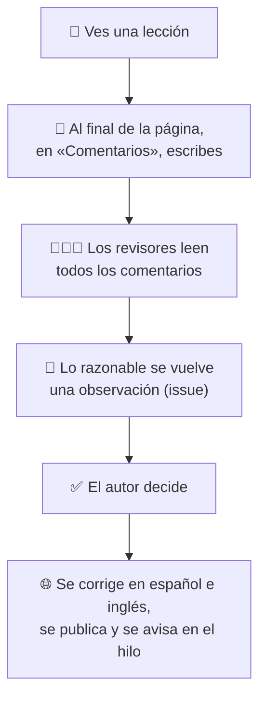
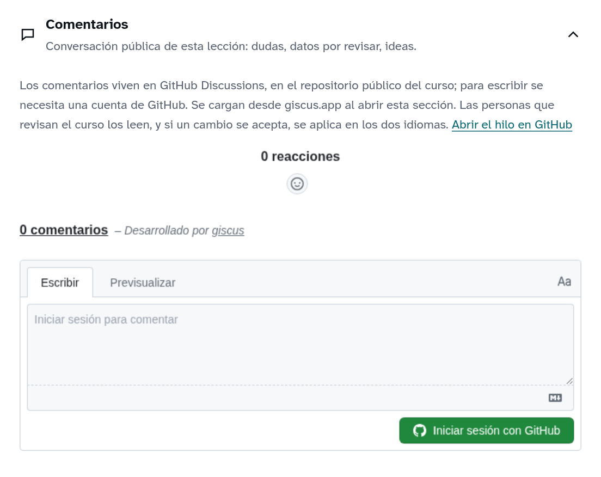

# Guía para revisar el curso

> **English version:** [REVIEWING.md](REVIEWING.md)

Gracias por ayudar a revisar **«IA generativa: de la neurona al chatbot»**. No necesitas saber programar: todo se hace desde el navegador.

El curso es para quien **nunca ha visto estos temas**. Si te pierdes, si algo va muy rápido o una palabra no se entiende, eso es justo lo que hay que mejorar. **No hay comentarios tontos.** Todo es público: escribe con naturalidad.

## Cómo funciona

Cada lección tiene **su propio hilo** de comentarios, el mismo en español y en inglés.

## 1. Preparación (una sola vez)

1. Entra a GitHub con tu cuenta: <https://github.com/login>.
2. Activa los avisos: en <https://github.com/abxda/abxda-academy> pulsa **Watch → Custom**, marca **Discussions** e **Issues** y pulsa **Apply**.

## 2. Ver una lección y comentar

1. Abre una lección de la [lista](#5-lecciones) y mírala completa.
2. Baja al final de la página y abre **Comentarios**:

   

3. La primera vez, pulsa **Iniciar sesión con GitHub** y autoriza a *giscus* (solo sirve para publicar a tu nombre).
4. Escribe: **en qué momento** (la frase o el minuto), **qué no se entendió** y, si se te ocurre, **qué te habría ayudado**.
5. Si alguien ya dijo lo mismo, ponle 👍 y agrega lo tuyo en una respuesta.

> ¿Quieres señalar un paso exacto? Es opcional: activa el modo revisión con <https://abxda.com/academy/es/ia-generativa/?revision=1> y usa **Comentar este paso** (llena solo la lección, el paso, el idioma y la narración). Para apagarlo: `?revision=0`.

## 3. Tu papel como revisor

Además de comentar, lee lo que escriben otras personas en los hilos: <https://github.com/abxda/abxda-academy/discussions>.

- **Si un comentario es razonable** (algo que confunde, un dato dudoso, una buena idea): en el menú **⋯** del comentario elige **Reference in new issue**, explica en dos líneas qué propones y créalo. Luego responde en el hilo: «Lo pasé a revisión: #número».
- **Si no aplica**, responde con amabilidad y explica por qué.
- **Nada se cambia sin la aceptación del autor.** Cuando un cambio se publica, se cierra el issue con el enlace y se avisa en el hilo.

## 4. Al terminar una lección (opcional)

Deja un comentario corto en su hilo: qué tan clara fue (de 1 a 5), **la idea principal con tus palabras** (sin buscarla en la lección) y cuánto tiempo te tomó.

## 5. Lecciones

Empieza por la parte 1, en orden. Una o dos lecciones por sesión es buen ritmo.

| # | Lección | Min | Comentarios |
|---|---|---|---|
| | **Parte 1 · Cómo aprende una máquina** | | |
| 1 | [Programar o aprender](https://abxda.com/academy/es/ia-generativa/lecciones/programar-vs-aprender/) | 12 | [hilo](https://github.com/abxda/abxda-academy/discussions/3) |
| 2 | [El mundo hecho de números](https://abxda.com/academy/es/ia-generativa/lecciones/el-mundo-hecho-de-numeros/) | 10 | [hilo](https://github.com/abxda/abxda-academy/discussions/4) |
| 3 | [Un modelo y su error](https://abxda.com/academy/es/ia-generativa/lecciones/un-modelo-y-su-error/) | 11 | [hilo](https://github.com/abxda/abxda-academy/discussions/5) |
| 4 | [Descenso del gradiente](https://abxda.com/academy/es/ia-generativa/lecciones/descenso-del-gradiente/) | 10 | [hilo](https://github.com/abxda/abxda-academy/discussions/6) |
| 5 | [La neurona artificial](https://abxda.com/academy/es/ia-generativa/lecciones/la-neurona-artificial/) | 11 | [hilo](https://github.com/abxda/abxda-academy/discussions/7) |
| 6 | [Lo que una neurona no puede](https://abxda.com/academy/es/ia-generativa/lecciones/lo-que-una-neurona-no-puede/) | 6 | [hilo](https://github.com/abxda/abxda-academy/discussions/8) |
| 7 | [Capas y activaciones](https://abxda.com/academy/es/ia-generativa/lecciones/capas-y-activaciones/) | 10 | [hilo](https://github.com/abxda/abxda-academy/discussions/9) |
| 8 | [Retropropagación](https://abxda.com/academy/es/ia-generativa/lecciones/retropropagacion/) | 9 | [hilo](https://github.com/abxda/abxda-academy/discussions/10) |
| 9 | [Entrenar bien: lotes, épocas y optimizadores](https://abxda.com/academy/es/ia-generativa/lecciones/entrenar-bien/) | 12 | [hilo](https://github.com/abxda/abxda-academy/discussions/11) |
| 10 | [Generalizar y evaluar](https://abxda.com/academy/es/ia-generativa/lecciones/generalizar-y-evaluar/) | 9 | [hilo](https://github.com/abxda/abxda-academy/discussions/12) |
| 11 | [Convoluciones y visión](https://abxda.com/academy/es/ia-generativa/lecciones/convoluciones-y-vision/) | 6 | [hilo](https://github.com/abxda/abxda-academy/discussions/13) |
| 12 | [Secuencias y memoria](https://abxda.com/academy/es/ia-generativa/lecciones/secuencias-y-memoria/) | 10 | [hilo](https://github.com/abxda/abxda-academy/discussions/14) |
| 13 | [El big bang del deep learning](https://abxda.com/academy/es/ia-generativa/lecciones/el-big-bang-del-deep-learning/) | 10 | [hilo](https://github.com/abxda/abxda-academy/discussions/15) |
| 14 | [Embeddings: el significado como geometría](https://abxda.com/academy/es/ia-generativa/lecciones/embeddings-significado-como-geometria/) | 11 | [hilo](https://github.com/abxda/abxda-academy/discussions/16) |
| | **Parte 2 · Generar: imágenes y lenguaje** | | |
| 15 | [Generar es aprender una distribución](https://abxda.com/academy/es/ia-generativa/lecciones/generar-es-aprender-una-distribucion/) | 10 | [hilo](https://github.com/abxda/abxda-academy/discussions/17) |
| 16 | [GAN: el falsificador y el detective](https://abxda.com/academy/es/ia-generativa/lecciones/redes-generativas-adversarias/) | 11 | [hilo](https://github.com/abxda/abxda-academy/discussions/18) |
| 17 | [Difusión: de ruido a imagen](https://abxda.com/academy/es/ia-generativa/lecciones/modelos-de-difusion/) | 12 | [hilo](https://github.com/abxda/abxda-academy/discussions/19) |
| 18 | [De texto a imagen](https://abxda.com/academy/es/ia-generativa/lecciones/de-texto-a-imagen/) | 13 | [hilo](https://github.com/abxda/abxda-academy/discussions/20) |
| 19 | [Predecir la siguiente palabra](https://abxda.com/academy/es/ia-generativa/lecciones/predecir-la-siguiente-palabra/) | 11 | [hilo](https://github.com/abxda/abxda-academy/discussions/21) |
| 20 | [Tokens: el alfabeto del modelo](https://abxda.com/academy/es/ia-generativa/lecciones/tokens/) | 11 | [hilo](https://github.com/abxda/abxda-academy/discussions/22) |
| 21 | [Atención](https://abxda.com/academy/es/ia-generativa/lecciones/atencion/) | 12 | [hilo](https://github.com/abxda/abxda-academy/discussions/23) |
| 22 | [El transformer completo](https://abxda.com/academy/es/ia-generativa/lecciones/el-transformer/) | 12 | [hilo](https://github.com/abxda/abxda-academy/discussions/24) |
| 23 | [Preentrenamiento](https://abxda.com/academy/es/ia-generativa/lecciones/preentrenamiento/) | 13 | [hilo](https://github.com/abxda/abxda-academy/discussions/25) |
| 24 | [Leyes de escala y costos](https://abxda.com/academy/es/ia-generativa/lecciones/leyes-de-escala-y-costos/) | 13 | [hilo](https://github.com/abxda/abxda-academy/discussions/26) |
| 25 | [GPUs, memoria y cuantización](https://abxda.com/academy/es/ia-generativa/lecciones/gpus-memoria-y-cuantizacion/) | 13 | [hilo](https://github.com/abxda/abxda-academy/discussions/27) |
| 26 | [Inferencia: cómo responde un modelo](https://abxda.com/academy/es/ia-generativa/lecciones/inferencia-como-responde-un-modelo/) | 13 | [hilo](https://github.com/abxda/abxda-academy/discussions/28) |
| | **Parte 3 · Del modelo al asistente y a la decisión** | | |
| 27 | [Ajuste fino y LoRA](https://abxda.com/academy/es/ia-generativa/lecciones/ajuste-fino-y-lora/) | 11 | [hilo](https://github.com/abxda/abxda-academy/discussions/29) |
| 28 | [De modelo base a asistente](https://abxda.com/academy/es/ia-generativa/lecciones/alineacion-de-asistentes/) | 14 | [hilo](https://github.com/abxda/abxda-academy/discussions/30) |
| 29 | [Modelos de razonamiento](https://abxda.com/academy/es/ia-generativa/lecciones/modelos-de-razonamiento/) | 12 | [hilo](https://github.com/abxda/abxda-academy/discussions/31) |
| 30 | [Contexto y memoria](https://abxda.com/academy/es/ia-generativa/lecciones/contexto-y-memoria/) | 12 | [hilo](https://github.com/abxda/abxda-academy/discussions/32) |
| 31 | [RAG: leer antes de responder](https://abxda.com/academy/es/ia-generativa/lecciones/rag-leer-antes-de-responder/) | 13 | [hilo](https://github.com/abxda/abxda-academy/discussions/33) |
| 32 | [Agentes y herramientas](https://abxda.com/academy/es/ia-generativa/lecciones/agentes-y-herramientas/) | 13 | [hilo](https://github.com/abxda/abxda-academy/discussions/34) |
| 33 | [Alucinaciones y límites](https://abxda.com/academy/es/ia-generativa/lecciones/alucinaciones-y-limites/) | 12 | [hilo](https://github.com/abxda/abxda-academy/discussions/35) |
| 34 | [Evaluar sistemas de IA](https://abxda.com/academy/es/ia-generativa/lecciones/evaluar-sistemas-de-ia/) | 12 | [hilo](https://github.com/abxda/abxda-academy/discussions/36) |
| 35 | [Riesgos y gobernanza](https://abxda.com/academy/es/ia-generativa/lecciones/riesgos-y-gobernanza/) | 13 | [hilo](https://github.com/abxda/abxda-academy/discussions/37) |
| 36 | [Estrategia para organizaciones](https://abxda.com/academy/es/ia-generativa/lecciones/estrategia-para-organizaciones/) | 12 | [hilo](https://github.com/abxda/abxda-academy/discussions/38) |
| 37 | [El mapa completo](https://abxda.com/academy/es/ia-generativa/lecciones/el-mapa-completo/) | 11 | [hilo](https://github.com/abxda/abxda-academy/discussions/39) |

## Seguimiento

- Hilos donde participaste: <https://github.com/abxda/abxda-academy/discussions?discussions_q=involves%3A%40me>
- Tus observaciones (issues): <https://github.com/abxda/abxda-academy/issues?q=author%3A%40me>

## Palabras de GitHub

| Palabra | Qué es |
|---|---|
| **Discussion** | El hilo de comentarios de una lección. |
| **Issue** | Una observación concreta para corregir. |
| **Reference in new issue** | Convierte un comentario en issue, con enlace al original. |
| **Watch** | Recibir avisos del repositorio. |

¿Dudas? Escribe a [academy@abxda.com](mailto:academy@abxda.com).
